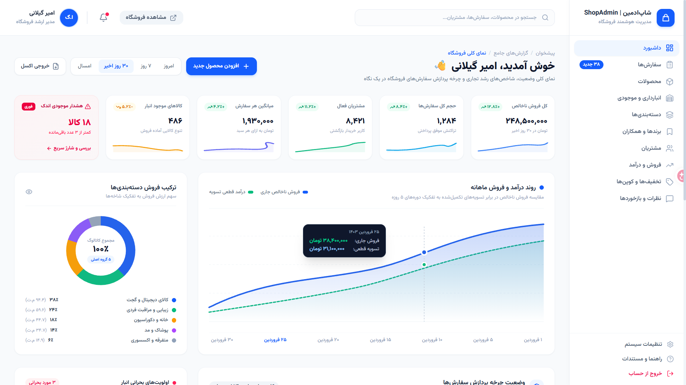

# ShopAdmin | Intelligent E-Commerce Admin Dashboard

> A modern, feature-rich, fully responsive, and production-ready E-Commerce Administrative Dashboard built with **React 19**, **TypeScript**, **Vite 8**, and **Tailwind CSS v4** featuring native **RTL (Right-to-Left)** support.

[](https://react.dev/)
[](https://www.typescriptlang.org/)
[](https://vitejs.dev/)
[](https://tailwindcss.com/)
[](https://reactrouter.com/)
[](LICENSE)

---

## 📌 Overview

**ShopAdmin** is a centralized, high-performance web dashboard designed for enterprise online store operators, merchants, and e-commerce logistics managers. It provides seamless management of orders, products, inventory, customers, financial analytics, discount campaigns, and customer reviews.

The user interface is engineered with pixel accuracy based on professional Google Stitch design standards, featuring a native **RTL** layout, fluid animations, typography powered by **Vazirmatn**, and zero external CDN image dependencies for full offline capability.

---

## 🖼️ Preview

<div align="center">



**ShopAdmin — Intelligent E-Commerce Admin Dashboard**

</div>

> A visual preview of the ShopAdmin dashboard, showcasing the RTL interface, analytics, order management, inventory, and e-commerce administration experience.

---
## ✨ Key Features & Modules

### 1. Interactive Analytics Dashboard (`/`)
- **KPI Metrics:** Track 30-day gross revenue, new orders count, conversion rate, and Average Order Value (AOV) with comparative period-over-period percentage indicators.
- **Revenue Trend Charts:** Granular timeframe filtering (Today, 7 Days, 30 Days, Year) with interactive SVG area gradients and metrics breakdowns.
- **Fulfillment Lifecycle Tracker:** Real-time visibility into active deliveries categorized across 5 stages (Pending Payment, Processing, Packing, In Transit, Delivered).
- **Critical Stock Warnings:** Automated alerts for items nearing depletion with direct one-click restocking navigation.
- **Top Performing Products:** Real-time rank of top 30-day sales items weighted by net profit margin.
- **Recent Orders Ledger:** Instant order status preview with one-click printable invoice generation.

### 2. Comprehensive Orders Management (`/orders` & `/orders/:id`)
- **Filterable Data Table:** Multi-parameter filtering by payment status (Paid, Pending, Wallet, Paya), shipping carriers (Courier, Post, Tipax Express), and custom date ranges.
- **Printable Official Invoice & Shipping Label Modal:** Clean printable invoices with barcodes, QR codes, item breakdowns, tax rates, and customer shipping labels.
- **Manual Order Creation:** On-the-fly order creation modal for phone/in-person merchant sales.
- **Order Details View:** Interactive order timeline tracking, customer contact profile, line item inventory specs, and status modification controls.

### 3. Product Catalog & Management (`/products`, `/products/new`, `/products/:id/edit`)
- **Dual View Modes:** Seamless toggle between tabular catalog view and visual grid cards.
- **Comprehensive Product Form:** Multi-category assignment, SKU/barcode generation, wholesale & retail pricing, discount percentage configuration, and warehouse storage slot assignments.
- **Stock Status Tags:** Instant visual cues for sufficient, reorder, critical, and out-of-stock items.

### 4. Smart Multi-Warehouse Inventory (`/inventory`)
- **Multi-Facility Logistics:** Track capacities across Central Warehouse (Tehran), West Distribution Center (Fath), and East Logistics Hub.
- **Real-Time Stock Audit:** Live breakdown of total physical units, reserved customer stock, and sellable quantities.
- **Movement Transaction Ledger:** Instant log of stock receipts, customer allocations, inter-warehouse transfers, and returns.

### 5. Categories, Brands & Partners (`/categories` & `/brands`)
- **Category Tree & Revenue Share:** Hierarchical catalog management paired with visual sales share distribution percentages.
- **Partner Brands Directory:** Official manufacturer and partner profiles with active product counts and brand logos.

### 6. Customer Relationship Management (`/customers` & `/customers/:id`)
- **Loyalty Tier Segments:** Customer categorization across VIP, Gold, Silver, Bronze, and New shopper tiers.
- **360° Customer Profile:** Complete address book, lifetime order history, cumulative spend, average basket size, and merchant private notes.

### 7. Sales, Financials & Settlements (`/sales`)
- **Financial Accounting Breakdown:** Gross GMV, net revenue, gateway transaction fees, value-added tax (VAT), and merchant net margin.
- **Gateway Distribution:** Payment split analytics across Saman Bank, ZarinPal, and Mellat Bank.
- **Settlement Ledger:** Daily banking Paya transfer tracking with exportable settlement statements.

### 8. Promotions & Coupon Campaigns (`/discounts`)
- **Custom Discount Coupons:** Percentage off, fixed amount vouchers, and free shipping promos.
- **Usage Caps & Min-Spend Safeguards:** Enforce usage limits, minimum purchase thresholds, and calendar expiration dates.
- **Seasonal Campaigns:** Featured Spring Festival 1404 promotion with team management permissions.

### 9. Reviews & Feedback Moderation (`/reviews`)
- **Customer Ratings:** 5-star scoring system with verified buyer badges.
- **Moderation Actions:** Approve, reject, or post official merchant support responses.
- **Photo Reviews Filter:** Quick filter for feedback containing real customer product photos.

### 10. Live Storefront Preview (`StorePreviewModal`)
- Modal providing merchants with an instant, interactive preview of how their online store appears to public shoppers without leaving the dashboard.

---

## 🛠 Tech Stack & Dependencies

| Layer | Technology | Version |
| :--- | :--- | :--- |
| **Frontend Framework** | React | `^19.0.1` |
| **Language** | TypeScript | `^7.0.2` |
| **Build Tool & Bundler** | Vite | `^8.3.0` |
| **CSS Framework** | Tailwind CSS (v4) with `@tailwindcss/vite` | `^4.3.3` |
| **Client Routing** | React Router DOM | `^7.18.4` |
| **Icons** | Lucide React | `^0.546.0` |
| **Typography** | Vazirmatn Persian Font | Google Fonts |
| **Package Manager** | npm / Bun | - |

---

## 📂 Project Structure

```text
├── public/
│   └── images/              # Local, offline image assets for all products & brands
├── src/
│   ├── components/
│   │   ├── common/          # Reusable modals (StorePreviewModal, OrderInvoiceModal)
│   │   └── layout/          # Core layout shells (Sidebar, TopHeader, DashboardLayout)
│   ├── data/                # Mock data repositories (products, orders, inventory, brands, etc.)
│   ├── pages/               # 17 standalone, fully-featured application views
│   │   ├── DashboardPage.tsx
│   │   ├── OrdersPage.tsx
│   │   ├── OrderDetailsPage.tsx
│   │   ├── ProductsPage.tsx
│   │   ├── NewProductPage.tsx
│   │   ├── InventoryPage.tsx
│   │   ├── CategoriesPage.tsx
│   │   ├── BrandsPage.tsx
│   │   ├── CustomersPage.tsx
│   │   ├── CustomerDetailsPage.tsx
│   │   ├── SalesPage.tsx
│   │   ├── DiscountsPage.tsx
│   │   ├── ReviewsPage.tsx
│   │   ├── ReportsPage.tsx
│   │   ├── SettingsPage.tsx
│   │   ├── ProfilePage.tsx
│   │   └── LoginPage.tsx
│   ├── types/               # Strict TypeScript interface declarations & models
│   ├── App.tsx              # Router table & navigation configurations
│   ├── index.css            # Tailwind directives, Vazirmatn font, and scrollbar rules
│   └── main.tsx             # React DOM entry point
├── index.html               # Main HTML wrapper with RTL and SEO meta tags
├── package.json             # Scripts & dependency definitions
├── tsconfig.json            # TypeScript compiler configuration
└── vite.config.ts           # Vite server & bundler configuration
```

---

## 🚀 Getting Started

### Prerequisites
- **Node.js** version `18.x` or higher (recommended: `20.x` or `22.x`)
- **npm**, **bun**, or **yarn**

### 1. Clone the repository
```bash
git clone <repository-url>
cd <project-directory>
```

### 2. Install dependencies
Using `npm`:
```bash
npm install
```
Or using `bun`:
```bash
bun install
```

### 3. Start the development server
```bash
npm run dev
```
The application will launch and be accessible at:
```text
http://localhost:3000
```

### 4. Build for Production
To compile and bundle optimized static assets for deployment:
```bash
npm run build
```
Production assets are generated in the `dist/` directory.

### 5. Preview Production Build
```bash
npm run preview
```

### 6. Type Checking & Code Quality
```bash
npm run lint
```

---

## 📱 Responsive & Adaptive Architecture

- **Desktop (≥ 1024px):** Fixed right sidebar with exact `h-20` header height matching the top navigation bar. Clean, scrollbar-free tables and full dashboard grids.
- **Tablet (768px – 1023px):** Collapsible drawer navigation with dedicated close controls. Data tables utilize subtle horizontal swipe scrolling without visible scrollbars (`no-scrollbar`).
- **Mobile (< 768px):** Single-column stacked cards, compact search headers, touch-friendly buttons, and high-density KPI cards.

---

## ⚡ Offline Readiness & Local Assets

All images used across the application—including product photographs, brand marks, and placeholder assets—are stored locally in `/public/images/`. The application requires **no external image CDN connection** to render high-fidelity mockups, ensuring full offline reliability.

---

## 👤 Default Administrator Credentials

- **Super Administrator:** امیر گیلانی (Amir Gilani)
- **Role:** Super Admin (Full access to all accounting, warehouse, orders, and system settings)
- **Email:** `amir.admin@shopadmin.ir`
- **Default Password:** `password123`

